


  

 

  <a href="https://www.instagram.com/miguelangel.wav/"></a>

 

  
   
  fondo pixel: <a href="https://opengameart.org/content/animated-cityscape-backgroundwallpaper">kotnaszynce</a> (CC0), recoloreado en azul

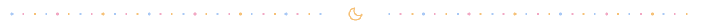


    
    
  

 


  <a href="https://github.com/SantiagoCusirramos/Banco_Nacional_Arequipa"></a>
  
  
  <a href="https://github.com/MiguelAngelQH/el-taller-de-mascaras"></a>

  
  

 


  
    
  


  
  &nbsp;
  <a href="https://www.instagram.com/miguelangel.wav/">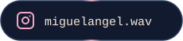</a>
    
  
    
  

